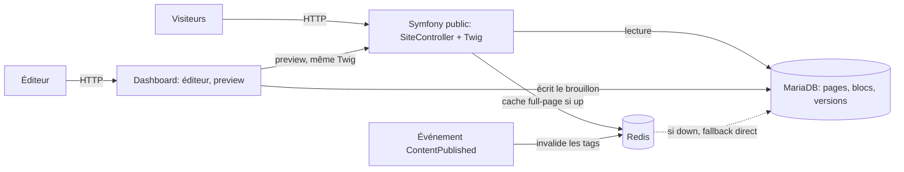

# Architecture

## Stack

- PHP + Symfony LTS, installé via Symfony CLI (pas de `composer create-project`)
- MariaDB via Doctrine ORM (entités + migrations), Redis comme cache/read model optionnel
- Twig : un seul moteur de rendu, partagé entre site public, preview admin et dashboard
- Symfony UX (Turbo, Stimulus, Live Components) ; assets JS en TypeScript compilés par esbuild, contrôleurs Stimulus écrits en TS
- Hébergement o2switch (mutualisé) ; déploiement par SSH, uniquement depuis la machine du propriétaire

## How it fits together

## Key decisions

- DDD + event-driven : `src/Domain`, `src/Application`, `src/Infrastructure`, `src/Presentation`. Événements métier (ex. `ContentPublished`) pour les effets de bord (invalidation cache). Pas de CQRS systématique.
- Principes SOLID, KISS, DRY, pas de sur-ingénierie. Design patterns imposés : Constant (noms d'événements, tags Redis) et Décorateur (cache Redis par-dessus le dépôt BDD, avec fallback si Redis est down).
- Références : OpenClassrooms (design patterns) et https://ngandu.dev/fr/blog/symfony-clean-architecture-ddd
- Le site public fonctionne sans Redis : le cache est un décorateur optionnel, jamais une dépendance.
- Un seul dépôt git public (MIT) ; pas de submodule, le contenu vit en BDD.
- Preview = même moteur Twig que le public : ne jamais dupliquer un moteur de rendu.

## Gotchas

- o2switch ne peut pas joindre github.com (DNS non autorisés) : le déploiement passe par SSH depuis la machine locale (voir `deployment.md`).
- o2switch fournit MariaDB et Redis en natif ; aucun cron o2switch n'est prévu (Redis est géré par l'hébergeur, sa chute n'est pas dramatique).
