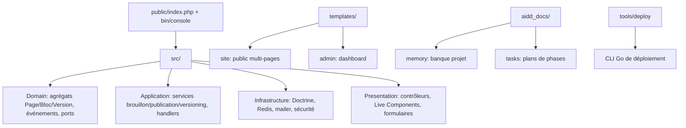

# Codebase Map

## Areas

- `src/Domain` : agrégats (`Page`, `Block`, `ContentVersion`), événements métier, interfaces de dépôts (ports)
- `src/Application` : services applicatifs (brouillon, publication, versioning), handlers d'événements
- `src/Infrastructure` : repositories Doctrine, cache Redis, mailer, sécurité
- `src/Presentation` : contrôleurs public/admin, Live Components Symfony UX, formulaires, templates Twig
- `public/` : front controller, assets compilés par l'asset mapper (TS via SWC)
- `tools/deploy/` : CLI Go de déploiement (voir `deployment.md`)
- `aidd_docs/` : `memory/` (banque projet) et `tasks/` (plans)

## Entry points

- Web : `public/index.php`
- CLI : `bin/console`
- Déploiement : `go run ./tools/deploy --env prod`
