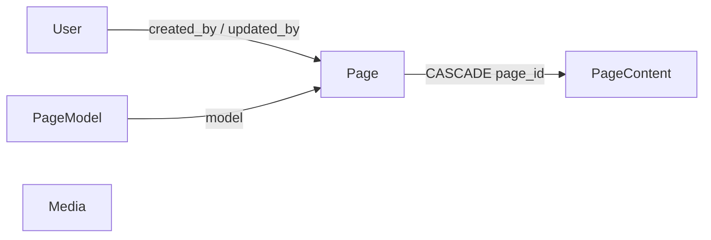

# Database

## Setup

- MariaDB (o2switch en prod, conteneur Docker en local), accédée via Doctrine ORM, config dans `config/packages/doctrine.yaml`
- DSN dans `.env` (hôte `database` = service compose, résolu dans le réseau docker) ; overrides persos dans `.env.local` (jamais commité)

## Schéma efolio (5 tables métier, migration 2026/11)

- `user` : email unique, `password_hash`, roles JSON, full_name, locale, `totp_secret` ?, `recovery_codes` JSON ?, `must_change_password` (toujours vrai à la création — invariant Domain)
- `media` : file_name, **alt_text obligatoire** (refusé vide par `Media::create`), path unique, mime_type, size
- `page_model` : name, `model_key` unique (pas « key » : mot réservé SQL), slots = liste ordonnée de clés de composants (la nav publique en dérive)
- `page` : ancre d'identité (model, created_by RESTRICT, updated_by SET NULL), contenu porté par `page_content` (inverse : `Page::$contents`, typé `iterable` — jamais de Collection Doctrine dans le Domain)
- `page_content` : une ligne par page × langue. locale validée contre `Locales`, slug, title, meta_title, meta_description, **draft JSON + published JSON** ; pas de colonne status : `isPublished()` = `published !== null` ; `publish()` **copie** draft → published + publishedAt (jamais un move : le brouillon reste éditable pendant que le public lit `published`)
- Uniques : `user.email`, `media.path`, `page_model.model_key`, `page_content(locale, slug)` **et** `page_content(page_id, locale)` — un contenu par langue et par page
- `messenger_messages` : transport Doctrine de Messenger (contact asynchrone, phase 9) — pas une table métier

## Mapping

- Entités PHP pures en `src/Domain/Entity` (zéro attribut ORM, zéro import Doctrine/Symfony) ; mapping **XML plat** `Entity.<Classe>.orm.xml` dans `src/Infrastructure/Doctrine/Mapping/` (jamais dans le Domain ni dans `config/`), bloc `mappings.Domain` de `doctrine.yaml`, `validate_xml_mapping: true`
- Repositories : composition (pas d'héritage `ServiceEntityRepository`), chacun n'implémente que son port `src/Domain/Repository/*Interface`, câblés par `#[AsAlias]` ; `save()` fait `touch()` + persist + flush

## Conventions

- Migrations Doctrine ordonnées par année et mois : `organize_migrations: BY_YEAR_AND_MONTH` (première : `migrations/2026/11/`)
- Fixtures `src/DataFixtures/AppFixtures` : purge par défaut au rechargement, **jamais `--append`** ; mots de passe hashés via l'adaptateur local `PlainPasswordUser` (le User Domain n'implémente aucune interface Symfony)
- Pas d'import depuis l'ancien WordPress : le contenu est saisi à la main dans le backoffice
