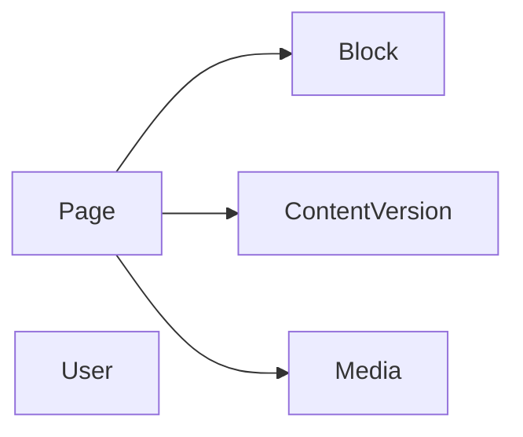

# Database

## Setup

- MariaDB (o2switch en prod, conteneur Docker en local), accédée via Doctrine ORM, config dans `config/packages/doctrine.yaml`
- DSN dans `.env.local` (jamais commité)

## Main entities

- `Page` : slug unique, titre, statut (draft/published), copie de travail `draft` (JSON), version en ligne `published` (JSON)
- `Block` : type, position, payload JSON, rattaché à une page
- `ContentVersion` : snapshot JSON d'une page à un instant, auteur, label
- `Media` : fichier uploadé (path, alt, mime, taille)
- `User` : email, hash de mot de passe, rôles, secret TOTP

## Conventions

- Migrations Doctrine ordonnées par année et mois : `organize_migrations: BY_YEAR_AND_MONTH` dans `config/packages/doctrine_migrations.yaml`
- Le contenu est versionné par snapshots JSON (`content_version`), pas par git
- Le public ne lit que `published` ; le brouillon reste dans `draft`
- Pas d'import depuis l'ancien WordPress : le contenu est saisi à la main (quasi vide)
