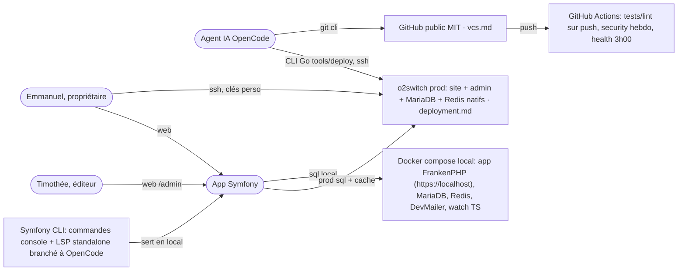

# Ecosystem

## Stack exacte

- PHP 8.4 (Homebrew, via `.php-version`) pour CLI/tests, Symfony LTS installé via **Symfony CLI**, Symfony LSP standalone dans `~/.local/bin` branché à OpenCode
- Serveur web local : conteneur **FrankenPHP** `app` dans docker compose (config `.docker/frankenphp/`, image épinglée `1.13.5-php8.4.27-alpine` = PHP 8.4.27, même version que `.php-version`) → https://localhost (HTTPS auto, ports 80/443)
- MariaDB + Redis : Docker compose en local, natifs o2switch en prod
- DevMailer présent dans `compose.yaml` (mails de dev en local)
