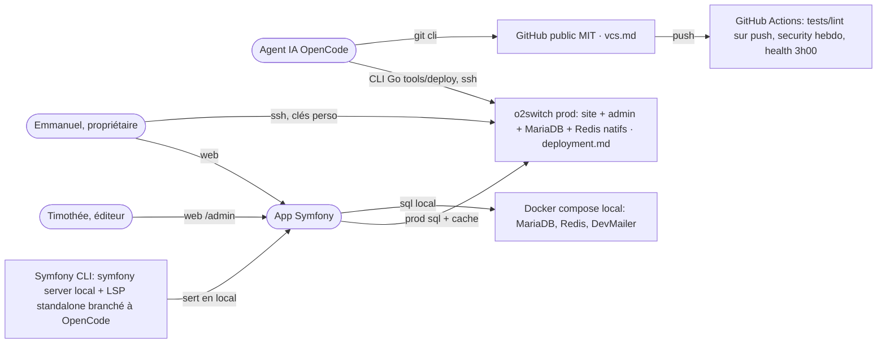

# Ecosystem

## Stack exacte

- PHP (Homebrew en local), Symfony LTS installé via **Symfony CLI**, Symfony LSP standalone ajouté comme LSP à OpenCode
- MariaDB + Redis : Docker compose en local, natifs o2switch en prod
- DevMailer présent dans `compose.yaml` (mails de dev en local)
